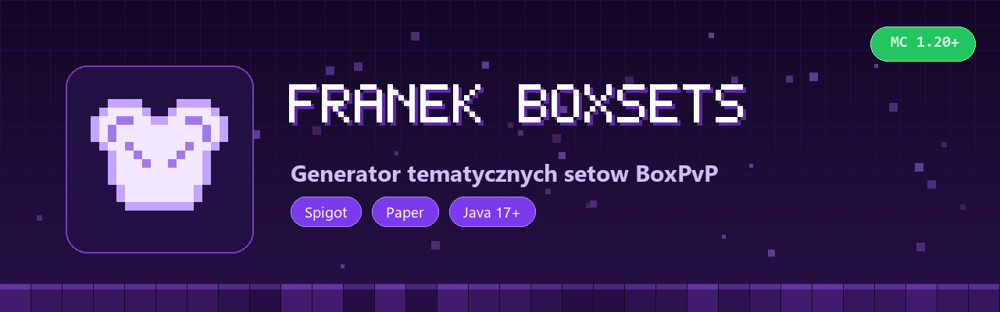
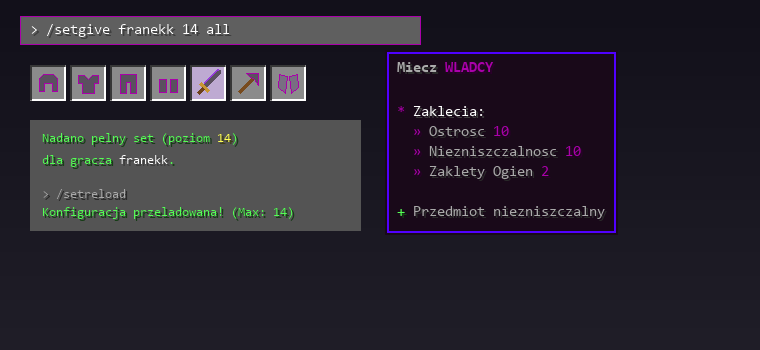

# FranekBoxSets



Plugin na sety pod BoxPvP (od poziomu 1 do 14). Daje gotowa zbroje, miecz, kilof, nozyce i elytre z kolorami HEX i wygladem w lore. Enchanty skaluja sie same wraz z poziomem setu.

## Podglad w grze



## Komendy

| Komenda | Co robi |
|---|---|
| `/setgive <gracz> <poziom> [przedmiot\|all]` | daje graczowi caly set albo pojedynczy item (`helmet`, `sword`, `pickaxe`, `elytra` itd.) |
| `/setreload` | przeladowuje `config.yml` |

Permisje: `franek.boxsets.give` i `franek.boxsets.reload` (domyslnie na `op`).

## Config

`plugins/FranekBoxSets/config.yml`, tworzy sie sam:

```yaml
max-level: 14

enchants:
  enchant-min: 1
  enchant-max: 10

sword:
  fire-aspect-from-level: 10
  fire-aspect-min: 1
  fire-aspect-max: 2

levels:
  1:
    theme: "ᴡɪʟᴋᴀ"
    hex: "#AAAAAA"
    material-tier: "LEATHER"
```

Mozna zmieniac nazwy setow, kolory HEX i typ zbroi (`LEATHER`, `IRON`, `DIAMOND`, `NETHERITE`).

## Instalacja

Jar z folderu [`releases/`](releases/) wrzucasz do `plugins/` na serwerze (Spigot / Paper 1.20.x+) i restart.

## Budowanie

```bash
mvn package
```

Wychodzi `target/FranekBoxSets-1.0.jar`.

## Licencja

Wszelkie prawa zastrzezone. Autor: franekk ([GitHub](https://github.com/Blejziak)).
